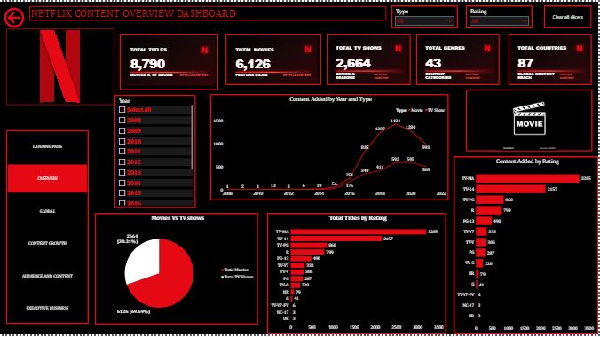
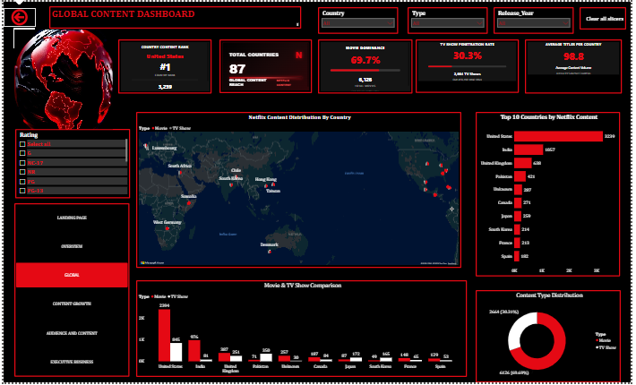
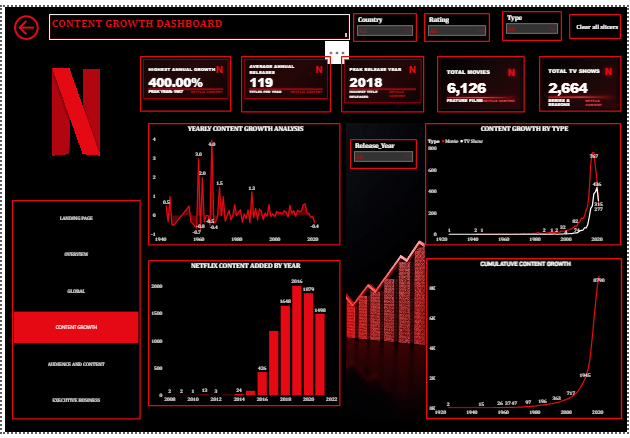

# 🎬 Netflix Content Analysis | Power BI

## 📌 Project Overview

This project presents an interactive analysis of Netflix's content catalogue using **Microsoft Power BI**. The dashboard explores Netflix Movies and TV Shows to uncover insights into content distribution, global presence, release trends, audience maturity ratings, and popular genres.

The project transforms raw data into meaningful business insights through data cleaning, analytical measures, and interactive visualizations, providing a comprehensive overview of Netflix's content offerings.

| Dataset Details | Description |
|---|---|
| Total Records | 8,790 |
| Total Columns | 10 |
| Content Types | Movies and TV Shows |
| Data Source | Kaggle |
| File Format | CSV |

### Dataset Features

The dataset contains the following columns:

- show_id – Unique identifier for each title.
- type – Content type, Movie or TV Show.
- title – Name of the content.
- director – Director of the content.
- country – Country or countries associated with the content.
- date_added – Date the content was added to Netflix.
- release_year – Original release year.
- rating – Content maturity rating.
- duration – Movie duration or TV Show seasons.
- listed_in – Genres and content categories.

## 🎯 Project Objectives

The objectives of this project were to:

- Analyze the distribution of Movies and TV Shows on Netflix.
- Identify countries with the highest content contribution.
- Examine Netflix content growth and release trends.
- Explore content maturity rating distributions.
- Identify popular genres and content categories.
- Develop interactive dashboards for effective data exploration.
- Present meaningful insights through visual storytelling.

## 🛠️ Tools & Technologies

| Tool | Purpose |
|---|---|
| power query | Data cleaning and preparation |
| Power BI | Data modeling, visualization, and dashboard development |
| DAX | Creating analytical measures and KPIs |
| Power Query | Data transformation and preparation |
| Power BI Service | Publishing and sharing the interactive dashboard |

## 🔍 Project Analysis

### 1. Netflix Content Overview
 
This analysis provides an overview of Netflix's content catalogue, focusing on:

- Total Titles
- Total Movies
- Total TV Shows
- Content distribution by type
- Content ratings
- Genre distribution

### 2. Global Content Insights

This section explores Netflix's geographical content distribution.

Key analyses include:

- Content distribution by country.
- Countries contributing the highest number of titles.
- Country content ranking.
- Geographical visualization of Netflix content.
- Global content distribution patterns.

### 3. Content Growth & Trend Analysis

This analysis examines Netflix's content development and release patterns.

Key analyses include:

- Content distribution by release year.
- Movie and TV Show trends over time.
- Cumulative title count.
- Yearly content growth patterns.
- Comparison of Movies and TV Shows across release periods.

### 4. Audience & Content Category Intelligence

This section explores Netflix's content maturity ratings and category distribution.

Key analyses include:

- Content rating distribution.
- Most common content rating.
- Popular genres.
- Genre distribution by content type.
- Movie and TV Show comparison by rating.
- Content category patterns.

**Note:** The dataset's rating field represents content maturity classifications, such as TV-MA, TV-14, and PG-13, rather than viewer satisfaction scores.

## 📈 Dashboard Features

The dashboard was designed to provide an interactive and user-friendly experience.

### Interactive Slicers
Users can filter dashboard results and explore content based on selected categories.

### Q&A Button
The landing page includes a Q&A button that allows users to ask questions about the data using natural-language queries.

### Page Navigation
Navigation buttons allow users to move seamlessly between the different dashboard pages.

### Clear All Slicers Button
This feature resets applied filters and restores the dashboard to its default view.

### Interactive Visualizations
Charts, KPIs, and other visual elements help users explore Netflix's content catalogue and identify meaningful patterns.

## 📊 Dashboard Preview

 

## 📌 Key Insights

The dashboard enables users to explore:

- The distribution of Movies and TV Shows within Netflix's catalogue.
- Countries contributing the largest content volumes.
- Netflix's content release patterns across different years.
- The distribution of content maturity ratings.
- Popular genres and category combinations.
- Differences between Movies and TV Shows across selected categories.

The interactive features allow users to investigate these patterns dynamically and explore the results based on their selected filters.

## 🚀 Power BI Service Dashboard

The interactive dashboard was published to Power BI Service to make it accessible for online exploration.

🔗 **[View Interactive Netflix Dashboard on Power BI Service](https://app.powerbi.com/view?r=eyJrIjoiMGM1NmQyNzQtYzc2Ni00YWNmLTgxM2UtZjQ5ZmY1ZWFiMDVjIiwidCI6IjQ4NTkyZTczLTE2OTUtNGVmMy1hYzg3LWM0ZDNjMGVhNDYzMyJ9)

Users can explore the published dashboard, interact with available filters, navigate between pages, and use the Q&A feature.

## 💡 Skills Demonstrated

- Data cleaning and preparation using Power Query.
- Data visualization and dashboard development using Power BI.
- DAX measures and KPI development.
- Data analysis and interpretation.
- Interactive dashboard design.
- Business intelligence and data storytelling.
- Analytical thinking and insight generation.

## 📝 Conclusion

This project demonstrates how data cleaning, analytical measures, and interactive visualizations can be combined to transform Netflix's content catalogue into an insightful business intelligence dashboard.

By exploring content distribution, global presence, release trends, maturity ratings, and genres, the dashboard provides a structured approach to understanding Netflix's content offerings.

The project also highlights my practical skills in **power query, Power BI, DAX, data visualization, and business intelligence**, while demonstrating my ability to develop interactive dashboards that support data exploration and insight generation.

---

### 👩‍💻 Author

**Rahman Azeezat Taiwo**

Entry level Data Analyst | Power BI | Excel | Data Visualization

🔗 GitHub: [Horpeyhemi](https://github.com/Horpeyhemi)

🔗 Project Repository: [Netflix Content Analysis](https://github.com/Horpeyhemi/NETFLIX)
